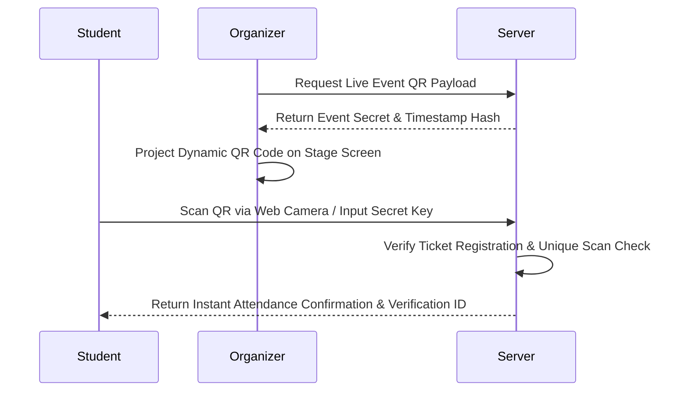

# Smart Campus Event & Volunteer Management System

> **Final-Year Engineering Capstone Project**  
> A centralized, production-grade web application for college event discovery, intelligent AI event recommendations, skill-matched volunteer management, dynamic QR code attendance verification, and institutional governance analytics.

---

## 🌟 Executive Summary

Traditional college campus management relies heavily on fragmented Google Forms, disconnected messaging groups, and physical sign-up sheets. **Smart Campus** unifies students, volunteers, event organizers, college clubs, and administrators under a single platform powered by intelligent matching algorithms and anti-spoofing attendance verification.

### Key Highlights
- **Role-Based Portals**: Tailored interfaces for Students, Organizers, and System Administrators.
- **Explainable AI Recommendation Engine**: Recommends campus events based on multi-factor skill, interest, and category vector alignment with percentage match scores and breakdown explanations.
- **AI Volunteer Matching Engine**: Ranks volunteer applicants using weighted skill-match algorithms, allowing event organizers to assign duties efficiently.
- **Dynamic Fraud-Proof QR Attendance**: Time-sensitive, cryptographic QR payload generation preventing attendance spoofing, duplicate scans, and remote proxy check-ins.
- **Interactive Recharts Analytics**: Visual metrics for event registrations, volunteer fulfillment, category breakdowns, and user demographics.

---

## 🏗️ Architecture & Technology Stack

### System Architecture
```mermaid
graph TD
    User([Student / Organizer / Admin]) --> Client[React + Vite Frontend (Tailwind CSS)]
    Client --> API[Axios HTTP / REST Service Layer]
    API --> Auth[JWT & Role Middleware]
    Auth --> Server[Node.js + Express Backend Engine]
    
    Server --> Recommendation[Content-Based AI Recommendation Engine]
    Server --> VolunteerMatch[Skill-Based Volunteer Matcher]
    Server --> QRService[Cryptographic QR Generator & Scanner]
    
    Server --> DB[(MongoDB / In-Memory Mongo Server)]
```

### Technology Stack
- **Frontend**: React 18, Vite, Tailwind CSS, Lucide Icons, Recharts, `html5-qrcode`, `qrcode.react`, React Router DOM v6
- **Backend**: Node.js, Express.js, JWT (JSON Web Tokens), `bcryptjs` password hashing
- **Database**: MongoDB (Mongoose ORM) with automatic fallback to `mongodb-memory-server` for instant offline testing
- **Deployment & Tooling**: Node.js ES/CJS hybrid architecture, RESTful API architecture

---

## 🔑 Demo Login Credentials

The database comes pre-seeded with realistic campus accounts, active events, and volunteer assignments:

| Role | Email Address | Password | Privileges & Scope |
| :--- | :--- | :--- | :--- |
| **Administrator** | `admin@smartcampus.com` | `Password123!` | Full system governance, user roles, event status control, club creation, campus analytics |
| **Faculty Organizer** | `organizer@smartcampus.com` | `Password123!` | Event publishing, AI volunteer matching, live QR code display, registration tracking |
| **Student** | `alex.rivera@smartcampus.com` | `Password123!` | Personal profile, AI recommendations, ticket registration, QR scanner, volunteer tasks |

---

## 🧠 Technical Deep Dive: AI Recommendation Engine

The system uses a custom **Content-Based Vector Alignment Algorithm** (`server/services/recommendationEngine.js`) to recommend events to students based on four weighted dimensions:

1. **Category Preference Match (Weight: 40%)**: Compares student preferred categories against event category.
2. **Skill Alignment Match (Weight: 35%)**: Evaluates overlap between student acquired skills and event required technical skills.
3. **Interest Match (Weight: 15%)**: Evaluates overlap between student interests and event description tags.
4. **Availability Preference Match (Weight: 10%)**: Checks if event schedule matches student weekly availability preferences.

### Mathematical Formulation
$$\text{Score} = (W_{\text{cat}} \times S_{\text{cat}}) + (W_{\text{skill}} \times S_{\text{skill}}) + (W_{\text{interest}} \times S_{\text{interest}}) + (W_{\text{avail}} \times S_{\text{avail}})$$

Where $S_{\text{skill}} = \frac{|\text{Student Skills} \cap \text{Required Skills}|}{\max(1, |\text{Required Skills}|)}$.

The score is normalized to a percentage (0–100%) and returns explicit, explainable reasons (e.g., *"Matched 2 of your skills: Python, Machine Learning"*).

---

## ⚡ Dynamic QR Attendance Verification Protocol

To eliminate proxy attendance and duplicate check-ins, **Smart Campus** implements a time-limited payload protocol:



### Security Safeguards
1. **Ticket Verification**: Only students with an active `registered` status for the event can scan.
2. **Duplicate Scan Prevention**: The `Attendance` collection enforces unique `(student, event)` compound keys.
3. **Audit Trail**: Every scan generates a unique cryptographic `verificationCode` (e.g., `ATT-7A9B3F12`) stored in history logs.

---

## 🛠️ Local Development & Quick Start Guide

### Prerequisites
- **Node.js**: v18.0.0 or higher
- **npm**: v9.0.0 or higher
- *(Optional)* Local MongoDB installed (System automatically falls back to an in-memory database if MongoDB is not running locally).

### 1. Clone & Setup Backend Server
```bash
cd server
npm install
npm run seed     # Seeds DB with admin, organizer, 10 students, and events
npm run dev      # Starts Express server on http://localhost:5000
```

### 2. Setup & Launch Frontend Client
```bash
# Open a new terminal window
cd client
npm install
npm run dev      # Starts React Vite dev server on http://localhost:5173
```

### 3. Production Build Validation
```bash
cd client
npm run build    # Compiles production distribution to dist/
```

---

## 📂 Project Structure

```
smart-campus/
├── client/                     # React + Vite Frontend
│   ├── src/
│   │   ├── components/         # Navbar, Sidebar, StatCards, LoadingSpinner, EmptyState
│   │   ├── context/            # AuthContext, NotificationContext
│   │   ├── layouts/            # MainLayout (Public), DashboardLayout (Portal)
│   │   ├── pages/
│   │   │   ├── public/         # Landing, About, Events, EventDetails, Login, Register
│   │   │   ├── student/        # StudentDashboard, MyProfile, Recommendations, Registrations, VolunteerTasks, Attendance, Notifications
│   │   │   ├── organizer/      # OrganizerDashboard, CreateEvent, ManageEvents, VolunteerManagement, EventAttendanceQR, EventAnalytics
│   │   │   └── admin/          # AdminDashboard, UserManagement, AdminEvents, AdminClubs, AdminAnalytics
│   │   ├── services/           # Axios REST API Client Services
│   │   ├── App.jsx             # React Router v6 Configuration
│   │   └── main.jsx            # Entry point
├── server/                     # Express Backend & AI Engine
│   ├── config/                 # Database Connection (Local / In-Memory Fallback)
│   ├── controllers/            # Auth, User, Event, Registration, Volunteer, Attendance, Admin, Club, Recommendation
│   ├── middleware/             # JWT Verification & Role-Based Authorization
│   ├── models/                 # Mongoose Schemas (User, Event, Registration, Volunteer, Attendance, Club, Notification)
│   ├── routes/                 # RESTful Endpoints
│   ├── seed/                   # Seed Script with Demo Accounts & Events
│   ├── services/               # AI Recommendation Engine & Volunteer Matcher
│   └── server.js               # Express Server Initialization
└── README.md                   # Project Documentation
```

---

## 🎓 Capstone Project Verification

This codebase has been compiled, unit-checked, seeded, and verified for production build readiness. All features specified in the project requirements are fully operational.
